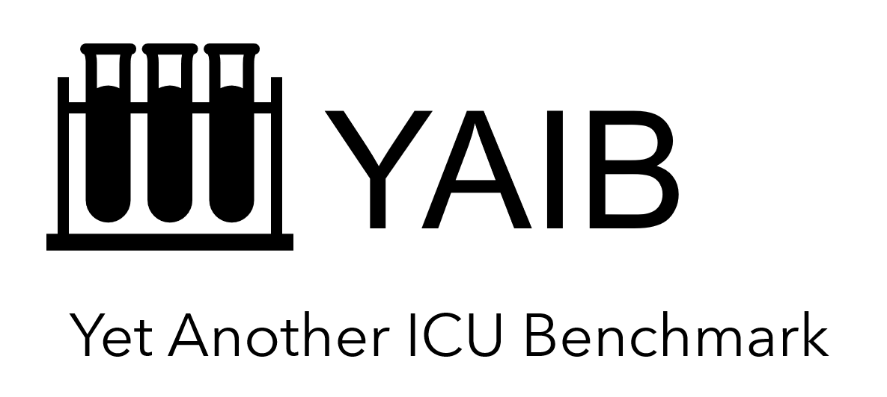
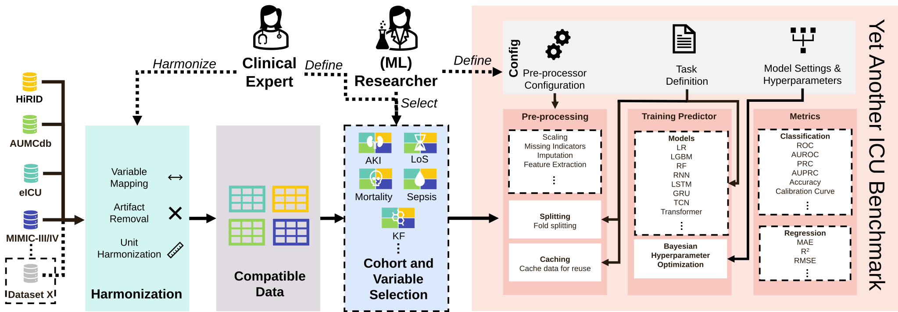

# Yet Another ICU Benchmark

{ width="320" }

Yet Another ICU Benchmark (YAIB) is a framework for clinical machine learning experiments on intensive care unit (ICU)
and other electronic health record (EHR) data. It takes a cohort of patient stays, preprocesses it, trains and tunes a
model with repeated cross-validation, and reports the results. Each step can be configured or replaced.

An experiment combines three parts, each chosen on the command line:

- **A dataset**: a cohort in YAIB's [parquet format](extending/datasets.md), for example generated from MIMIC, eICU,
    HiRID or AUMCdb with [YAIB-cohorts](getting-started/cohorts.md).
- **A task**: binary classification, regression or imputation, set by a [task config](user-guide/configuration.md).
- **A model**: one of the [built-in models](#models) or [your own](extending/models.md), with its hyperparameters
    and search space in a model config.



## Get started

<div class="grid cards" markdown>

- **[Installation](getting-started/installation.md)**: install YAIB with `uv`.
- **[Quickstart](getting-started/quickstart.md)**: train a first model on the included demo data in a minute.
- **[Running experiments](user-guide/running-experiments.md)**: how datasets, tasks and models fit together.
- **[Extending YAIB](extending/models.md)**: add your own model, task, preprocessing or metric.

</div>

## Datasets

YAIB supports these ICU datasets out of the box:

| Dataset                 | [MIMIC-III](https://physionet.org/content/mimiciii/) / [IV](https://physionet.org/content/mimiciv/) | [eICU-CRD](https://physionet.org/content/eicu-crd/) | [HiRID](https://physionet.org/content/hirid/1.1.1/) | [AUMCdb](https://doi.org/10.17026/dans-22u-f8vd) |
| ----------------------- | --------------------------------------------------------------------------------------------------- | --------------------------------------------------- | --------------------------------------------------- | ------------------------------------------------ |
| Admissions              | 40k / 73k                                                                                           | 200k                                                | 33k                                                 | 23k                                              |
| Version                 | v1.4 / v2.2                                                                                         | v2.0                                                | v1.1.1                                              | v1.0.2                                           |
| Frequency (time series) | 1 hour                                                                                              | 5 minutes                                           | 2 / 5 minutes                                       | up to 1 minute                                   |
| Originally published    | 2015 / 2020                                                                                         | 2017                                                | 2020                                                | 2019                                             |
| Origin                  | USA                                                                                                 | USA                                                 | Switzerland                                         | Netherlands                                      |

Demo cohorts from the openly available MIMIC-III and eICU demo datasets are included in the repository, so you can run
YAIB without credentialed access. See [Datasets and access](getting-started/datasets.md).

## Tasks

| No  | Task                      | Frequency                  | Type                  |
| --- | ------------------------- | -------------------------- | --------------------- |
| 1   | ICU mortality             | Once per stay (after 24 h) | Binary classification |
| 2   | Acute kidney injury (AKI) | Hourly (within 6 h)        | Binary classification |
| 3   | Sepsis                    | Hourly (within 6 h)        | Binary classification |
| 4   | Kidney function (KF)      | Once per stay              | Regression            |
| 5   | Length of stay (LoS)      | Hourly (within 7 days)     | Regression            |

New tasks can be added; see [Adding tasks](extending/tasks.md).

## Models

| Type          | Models (`-m`)                                                                                                                                                                                                                                                          |
| ------------- | ---------------------------------------------------------------------------------------------------------------------------------------------------------------------------------------------------------------------------------------------------------------------- |
| Classical ML  | `LogisticRegression`, `ElasticNet`, `RFClassifier`, `SVMClassifier`, `SVMRegressor`, `LGBMClassifier`, `LGBMRegressor`, `XGBClassifier`, `CBClassifier` (CatBoost), `BRFClassifier` and `RUSBClassifier` (imbalanced-learn)                                            |
| Deep learning | `RNN`, `LSTM`, `GRU`, `GRUD` (GRU-D), `TCN`, `Transformer`, `LocalTransformer`, `BAT` (Bi-Axial Transformer), `Mamba`                                                                                                                                                  |
| Imputation    | `Mean`, `Median`, `Zero`, `MostFrequent`, `KNN`, `MICE`, `ICE`, `MissForest`, `GAIN`, `Miwae`, `Miracle`, `Sinkhorn`, `SoftImpute`, `MLP`, `RNN`, `BRNN`, `NP`, `Attention`, `BRITS`, `SAITS`, `CSDI`, `Diffusion`, `Simple_Diffusion`, `DiffWave`, `SSSDS4`, `SSSDSA` |

The model name is the name of its config file in `configs/prediction_models/` or `configs/imputation_models/`.

## Related repositories

- [YAIB-cohorts](https://github.com/rvandewater/YAIB-cohorts): cohort generation for YAIB.
- [YAIB-models](https://github.com/rvandewater/YAIB-models): pretrained models for YAIB.
- [ReciPys](https://github.com/rvandewater/ReciPys): the preprocessing package behind YAIB's pipelines.
- All YAIB-related repositories: [github.com/stars/rvandewater/lists/yaib](https://github.com/stars/rvandewater/lists/yaib).

## Citation

If you use YAIB in your research, please cite the
[ICLR 2024 paper](https://openreview.net/forum?id=ox2ATRM90I) ([arXiv:2306.05109](https://arxiv.org/abs/2306.05109)):

```bibtex
@inproceedings{vandewaterYetAnotherICUBenchmark2024,
  title = {Yet Another ICU Benchmark: A Flexible Multi-Center Framework for Clinical ML},
  shorttitle = {Yet Another ICU Benchmark},
  booktitle = {The Twelfth International Conference on Learning Representations},
  author = {van de Water, Robin and Schmidt, Hendrik Nils Aurel and Elbers, Paul and Thoral, Patrick and Arnrich, Bert and Rockenschaub, Patrick},
  year = {2024},
  month = oct,
  urldate = {2024-02-19},
  langid = {english},
}
```

## Acknowledgements

This project has been developed partially under the funding of "Gemeinsamer Bundesausschuss (G-BA)
Innovationsausschuss" in the framework of "CASSANDRA - Clinical ASSist AND aleRt Algorithms" (project number
01VSF20015). We would like to acknowledge the work of Alisher Turubayev, Anna Shopova, Fabian Lange, Mahmut Kamalak, Paul
Mattes, and Victoria Ayvasky for adding PyTorch Lightning, Weights and Biases compatibility, and several optional
imputation methods to a later version of the benchmark repository.

We do not own any of the datasets used in this benchmark. This project uses heavily adapted components of the
[HiRID benchmark](https://github.com/ratschlab/HIRID-ICU-Benchmark/). The demo datasets have been released under an
[Open Data Commons Open Database License (ODbL)](https://opendatacommons.org/licenses/odbl/1-0/).
