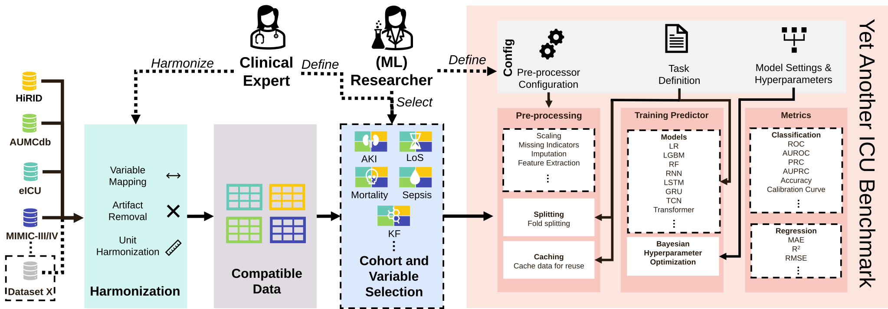
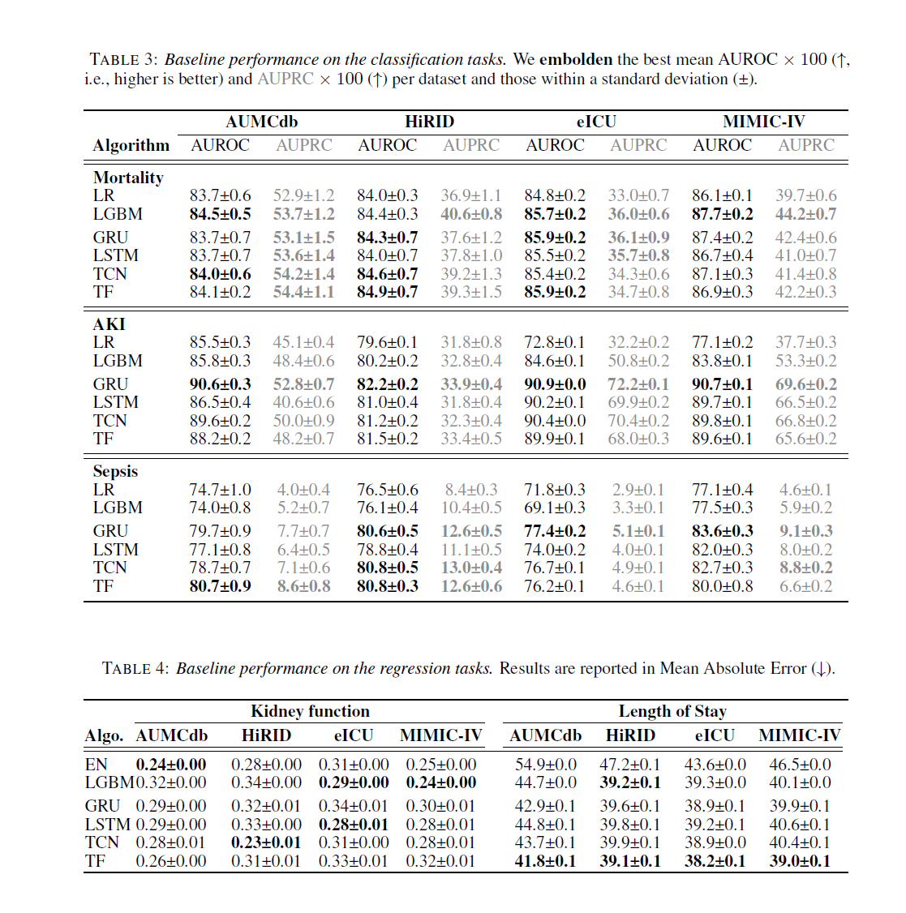

# Reproducing paper results

This page describes how to run the benchmarks of
[Yet Another ICU Benchmark: A Flexible Multi-Center Framework for Clinical ML](https://arxiv.org/abs/2306.05109)
(ICLR 2024).

An experiment in YAIB consists of four steps:

1. Defining clinical concepts from the raw data.
2. Extracting the patient cohort and specifying the prediction task.
3. Preprocessing and feature generation.
4. Training and evaluation of the model.



!!! note "Code version"

    YAIB has changed since the paper was published: dependencies were updated, Optuna replaced scikit-optimize for
    tuning, search spaces were revised, and many bugs were fixed. The current version will not reproduce the paper's
    numbers exactly. To compare with the paper, use the
    [releases](https://github.com/rvandewater/YAIB/releases) from that time, and report which commit you used.

## Requirements

[Install YAIB](../getting-started/installation.md). To get the cohorts, get access to the datasets
([Datasets and access](../getting-started/datasets.md)) and extract the cohorts with
[YAIB-cohorts](../getting-started/cohorts.md).

## Training

The sweep files in `experiments/` train all models of the paper. Create the two sweeps from the repository root:

```bash
uv run wandb sweep --verbose experiments/benchmark_classification.yml
uv run wandb sweep --verbose experiments/benchmark_regression.yml
```

Then start agents for them:

```bash
uv run wandb agent <sweep_id>
```

See [Weights & Biases](weights-and-biases.md) for running the agents on a cluster.

To run the same benchmarks on the included demo cohorts, use `experiments/demo_benchmark_classification.yml` and
`experiments/demo_benchmark_regression.yml`.

## Evaluation

Each run is evaluated on its test splits after training; the log directory is set in the sweep files. We recommend the
W&B web interface to compare the results. The [Quickstart](../getting-started/quickstart.md#look-at-the-results)
describes the result files.

## Pretrained models

Pretrained models are available in the [YAIB-models](https://github.com/rvandewater/YAIB-models) repository. To evaluate
one on your data, point `--source-dir` at its fold folder; see
[Evaluation and transfer](evaluation-and-transfer.md#evaluate-on-another-dataset).

## Results

The results from the paper:



Note that there were major changes between the classification and the regression experiments. The results should still
be comparable overall.
